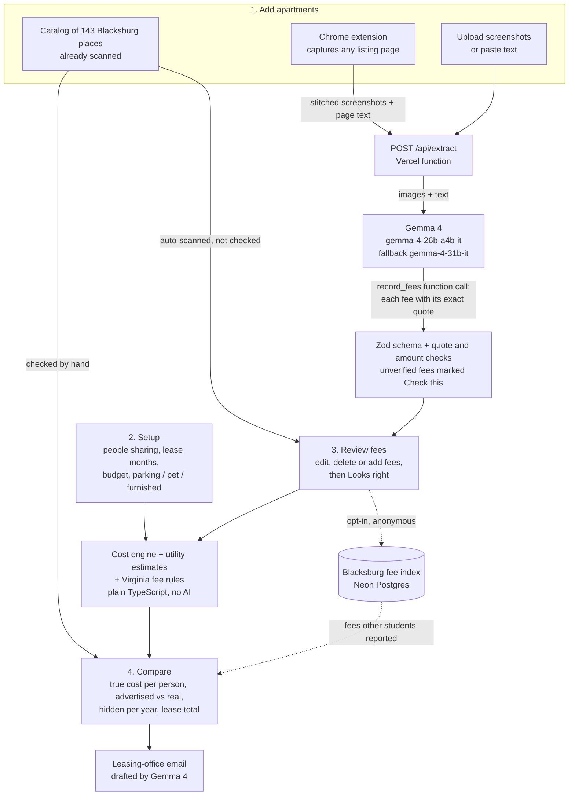

# True Cost

**The rent you see isn't the rent you pay.** True Cost uses Gemma 4 to read apartment listings, find every fee, and show what each place really costs per person per month, side by side, before you sign.

Live app: **[true-cost-xi.vercel.app](https://true-cost-xi.vercel.app)**. Built at GDG Build with AI x Hacktoberfest 2026, Virginia Tech (Oct 24–25, 2026).

## The problem

Blacksburg students pick apartments months ahead, and they compare them by the headline per-bed price. That price leaves a lot out. Admin fees, utility service fees, parking, amenity fees and reconditioning fees sit on separate tabs, in fine print, or in the lease itself. Real examples from Blacksburg listings:

- Brexx: a $150 admin fee, plus a $62 utility service fee, and a note that base rent may leave out non-optional fees.
- Hub: a $200 admin fee and $30 a month for parking.
- Tee Street: a $299 reconditioning fee per resident.
- Foxridge: $74 a month in required fees.

Virginia now requires advertised prices to include mandatory fees (Va. Code § 59.1-608) and leases to itemize charges on the first page (Va. Code § 55.1-1204.1). Few students know that, and nobody adds the numbers up for them. Splitting a unit with roommates makes the math harder still, because some fees are charged per person and some per unit.

## What True Cost does

You tell it who's splitting, pick or capture up to three apartments, check the fees it found, and get one number per apartment: the true monthly cost per person, with every fee counted.



Everything you enter stays in your browser (localStorage). There are no accounts and screenshots are never stored.

## Features

### Setup
Choose how many people share the unit (1 to 6), how long the lease is, an optional monthly budget per person, and which extras you need (parking, a pet, a furnished unit). Optional fees for the extras you need are counted automatically; the rest are left out.

### Catalog of Blacksburg apartments
The Apartments step opens on 143 Blacksburg places whose fees were read ahead of time, so you can compare without adding anything:

- 8 complexes checked by hand against their listings.
- 117 listings from offcampus.vt.edu: apartment communities, houses, townhouses, condos and duplexes.
- 18 complexes auto-scanned from their own websites with the same Gemma extraction the app uses.

Search the list and click a card to add it. Hand-checked places go straight to Compare. Auto-scanned ones open Review first, because nobody has checked their fees yet. Every card shows its source and the date it was read, and links to the original listing.

### Chrome extension
For a listing that isn't in the catalog, the True Cost extension reads it in one click:

1. It scrolls the whole listing page and screenshots it screen by screen, hiding sticky headers and chat buttons so they don't repeat, then puts your scroll position back.
2. It stitches the screenshots into up to 5 images, sized to fit the upload limit, and adds the page's text.
3. It sends them to True Cost, and Gemma 4 reads the fees, usually in 10 to 20 seconds.
4. A side panel shows each step live, then the advertised rent and every fee, grouped as required, unclear or optional, each with the quote it came from.
5. **Review in True Cost** or **Add to Compare** opens the app with the apartment already filled in.

If something fails, the panel says what went wrong and offers Try again. The extension holds no API key and only sends data to the True Cost app. It works in Chrome and other Chromium browsers such as Brave and Edge. Install steps are in [extension/README.md](extension/README.md).

### Upload or paste
You can also drop, click or paste up to 5 screenshots, or paste listing text. Images are resized in the browser before they're sent.

### Gemma 4 fee extraction
`POST /api/extract` sends the images and text to Gemma 4, which returns structured fees through function calling: name, amount, how often it's charged, whether it's per person or per unit, whether it's required or refundable, and the exact quote it came from. Each quote and amount is checked against the listing. Anything that can't be verified is marked "Check this".

### Review fees
Every fee shows its source quote. Low-confidence fees sort to the top with a "Check this" badge. You can edit any field, delete a fee, add one by hand, or correct the advertised price. Utilities the listing doesn't include get Blacksburg estimates, labelled "Estimate". Numbers only show up after you click **Looks right**.

### Compare
One column per apartment, with:

- The true monthly cost per person, beside the advertised price.
- How much a year isn't in the headline price.
- A bar splitting rent, recurring fees, utilities and one-time fees spread over the lease.
- The total cost over the lease, and your budget line if you set one.

A sentence above the columns gives the answer ("X is $N a month cheaper per person than Y, with every fee counted"), and the cheapest place is highlighted. "See every fee" opens the itemized breakdown, where you can switch fees in or out.

### Virginia fee rules
Rules in code (`lib/flags.ts`) check confirmed fees against Virginia law: advertised prices that leave out mandatory fees (§ 59.1-608), security deposits above two months' rent (§ 55.1-1226), and first-page fee itemization (§ 55.1-1204.1). Each one cites its statute and links to [Virginia Law Help](https://www.virginialawhelp.org/). This is information, not legal advice.

### Leasing-office email
One click drafts a polite email to the leasing office that asks for the full fee sheet and turns any Virginia flags into questions rather than accusations. Gemma 4 writes it. If Gemma fails, or the draft mentions an amount it wasn't given, a plain template is used instead. The To line is filled in only when the listing shows the office's email. Copy it, or open it in Gmail, Outlook or your mail app.

### Blacksburg fee index
If you tick the box on Review (it's off by default), the fees you confirmed are shared anonymously: only the complex name and the fee amounts. Compare then shows fees other students reported at the same complex that aren't on your list, such as "Utility service fee, $62/month, reported 3 times". It stores only fees a person has checked, never raw model output, images, quotes or anything about you. Rate limiting uses a hash that changes daily, so submissions can't be linked across days.

## AI model

- **Model:** `gemma-4-26b-a4b-it` (fallback `gemma-4-31b-it`) through the Gemini API, using the `@google/genai` SDK.
- **License:** Gemma is provided under the [Gemma Terms of Use](https://ai.google.dev/gemma/terms).
- **What it does:** reads screenshots and listing text, returns structured fees through the `record_fees` function with the exact quote for each, and drafts the leasing-office email.
- **What it never does:** arithmetic or legal judgments. Code in `lib/cost.ts` and `lib/flags.ts` does both.
- **Cost:** about one Gemma call per apartment, on the smaller 26B A4B model. Picking from the catalog needs no call at all.

## Responsible AI

- Every fee shows its source quote, and quotes and amounts are checked against the listing. Anything unverified is marked "Check this".
- You review fees before any numbers are shown.
- No accounts. Screenshots are processed in memory and never stored. Sharing with the fee index is off unless you turn it on.
- Virginia flags cite the statute and link to legal aid, and are worded as questions to ask.
- Accessible: WCAG AA contrast, full keyboard flow, labelled controls, light and dark themes, and motion that turns off under `prefers-reduced-motion`.

## Evaluation

`npm run eval` scores extraction on 8 hand-labelled Blacksburg listings in `eval/cases/` and writes `eval/results.json`. Latest run: **100% precision and 100% recall** (33 of 33 fees, no extras), advertised price right on 8 of 8.

## Run it locally

```bash
npm install
cp .env.example .env.local   # then paste your key from https://aistudio.google.com
npm run dev                  # http://localhost:3000
npm test                     # unit tests
npm run eval                 # extraction eval
```

`GEMINI_API_KEY` is required. `DATABASE_URL` (Neon Postgres) is only needed for the fee index; without it the app still works and the index section stays hidden.

## Tech stack

Next.js 15 (App Router), TypeScript, Tailwind CSS v4, shadcn/ui, Zustand, Zod, Gemma 4 through `@google/genai`, Neon Postgres, deployed on Vercel. The extension is a Manifest V3 Chrome extension with a side panel.

## Team

Sam ([@sam044](https://github.com/sam044)) and Andy ([@andyshah17](https://github.com/andyshah17)).

## License

[Apache-2.0](LICENSE)
